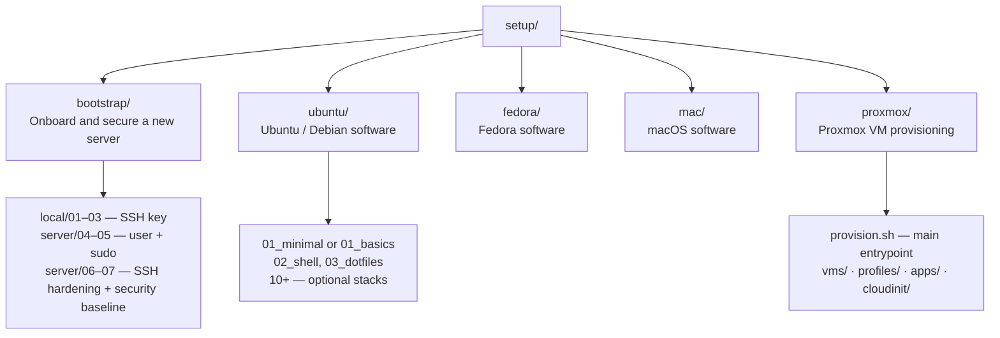

# setup

Personal machine setup scripts for macOS, Linux servers, and Proxmox VMs.
Scripts are organised by platform and numbered by phase so you always know
what to run and in what order.

---

## Repo Structure



---

## Quick Start

### First: set up `~/.env`

All scripts read config from a single canonical file at `$HOME/.env`.
The repo-root `.env` is a symlink to it (back-compat for docker-compose
`env_file:` directives).

```bash
cp .env.example ~/.env
chmod 600 ~/.env
ln -sf ~/.env .env       # at the repo root
# Edit ~/.env: SETUP_USER, SETUP_HOST, DOTFILES_REPO, GH_TOKEN,
#              RAGFLOW_API_KEY, LLAMACPP_*, etc.
```

There are no per-subdir `.env` files (no `proxmox/.env`, no `ragflow/.env`).
Single source of truth at `~/.env`.

Don't copy your workstation's `~/.env` to a server. Give each server only the
values it needs.

---

### New Linux server

**1. Onboard and secure it, from your local machine.**
See [bootstrap/README.md](bootstrap/README.md) for what each step does.

```bash
bash bootstrap/local/01_keygen.sh                 # this server's own key
SSH_USER=root bash bootstrap/local/02_key_upload.sh
SSH_USER=root bash bootstrap/server/04_adduser.sh # user + their SSH key
SSH_USER=root bash bootstrap/server/05_sudoers.sh
bash bootstrap/local/03_key_test.sh
bash bootstrap/server/06_sshd_harden.sh           # key-only, no root login
bash bootstrap/server/07_baseline.sh              # updates, ufw, fail2ban
```

**2. Install software, on the server as your user.** Pick one first step:

```bash
git clone https://github.com/marsmike/setup.git ~/Developer/setup
cd ~/Developer/setup

bash ubuntu/01_minimal.sh           # Claude Code, herdr, tmux
# or
bash ubuntu/01_basics.sh --server   # everything except ollama and fonts

bash ubuntu/02_shell.sh             # oh-my-zsh + powerlevel10k + plugins
bash ubuntu/03_dotfiles.sh          # chezmoi dotfiles + tpm
exec zsh
```

---

### Ubuntu desktop or MiniPC

```bash
bash ubuntu/01_basics.sh      # packages + Docker + most optional tools
bash ubuntu/02_shell.sh       # oh-my-zsh + powerlevel10k + plugins
bash ubuntu/03_dotfiles.sh    # chezmoi dotfiles + tpm
exec zsh
```

---

### macOS

```bash
bash mac/01_basics.sh         # Homebrew + baseline packages
bash mac/02_shell.sh          # oh-my-zsh + powerlevel10k + plugins
bash mac/03_dotfiles.sh       # chezmoi dotfiles + tpm
exec zsh && p10k configure
```

---

### Proxmox VM Provisioning

Provision a VM from any machine (Mac, Linux, MobaXterm). Credentials come from
the `PROXMOX_*` keys in `~/.env`.

```bash
./proxmox/provision.sh --dry-run proxmox/vms/ragflow.yaml
./proxmox/provision.sh proxmox/vms/ragflow.yaml
```

See **[proxmox/README.md](proxmox/README.md)** for full documentation, including
Mermaid diagrams of the provisioning flow, VM model, and bootstrap sequence.

---

## Script Reference

| Script | What it does |
|--------|-------------|
| **bootstrap/ — run locally, over SSH** | |
| `bootstrap/local/01_keygen.sh` | Generate this server's ED25519 key and add it to `~/.ssh/config` |
| `bootstrap/local/02_key_upload.sh` | `ssh-copy-id` the key to the connecting account |
| `bootstrap/local/03_key_test.sh` | Verify key login and print authorized fingerprints |
| `bootstrap/server/04_adduser.sh` | Create `SETUP_USER`, add groups, install the key |
| `bootstrap/server/05_sudoers.sh` | Passwordless sudo, validated before install |
| `bootstrap/server/06_sshd_harden.sh` | Key-only SSH, no root login, with automatic rollback |
| `bootstrap/server/07_baseline.sh` | Updates, automatic security updates, ufw, fail2ban |
| **ubuntu/ — run on the machine** | |
| `ubuntu/01_minimal.sh` | Claude Code (auto permission mode, set in `~/.config/claude-permission-mode`), herdr, tmux, and what the dotfiles require |
| `ubuntu/01_basics.sh` | Full package and tool set; `--server` skips ollama and fonts |
| `ubuntu/02_shell.sh` | oh-my-zsh, powerlevel10k, autosuggestions, syntax highlighting |
| `ubuntu/03_dotfiles.sh` | chezmoi dotfiles (`DOTFILES_REPO`) + tpm |
| `ubuntu/10_containers.sh` | ctop, dive, lazydocker, k9s, kubectl, helm, k3d, kind, minikube |
| `ubuntu/20_gui.sh` | flatpak, ghostty, Obsidian, Discord, WezTerm, Chrome, Firefox |
| `ubuntu/26_handy.sh` | Handy local voice dictation |
| `ubuntu/30_vms.sh` | VM tooling |
| `ubuntu/40_remote.sh` | Coder and Teleport |
| `ubuntu/50_amd_gpu.sh` | AMD GPU setup |
| `ubuntu/51_ollama.sh` | Ollama |
| `ubuntu/52_llamacpp_vulkan.sh` | llama.cpp Vulkan stack launcher |
| `ubuntu/53_ragflow.sh` | RagFlow launcher |
| `ubuntu/54_openwebui.sh` | Open WebUI |
| `ubuntu/55_mineru.sh` | MinerU |
| `ubuntu/benchmark_llm.sh` | LLM benchmark |
| `ubuntu/test_pipeline.sh` | Test the Ubuntu pipeline in Docker or a VM |
| **fedora/** | |
| `fedora/01_basics.sh`, `02_shell.sh`, `03_dotfiles.sh` | Same phases as Ubuntu |
| **mac/** | |
| `mac/01_basics.sh`, `02_shell.sh`, `03_dotfiles.sh` | Same phases as Ubuntu, via Homebrew |
| `mac/10_containers.sh` | Container tools |
| `mac/20_gui.sh` | GUI apps |
| **tools/** | |
| `tools/10_claude_agents.sh` | Persistent Claude tmux sessions (backup copy) |

---

## Server security notes

- **One SSH key per server.** `01_keygen.sh` creates `~/.ssh/id_ed25519_<host>` and
  configures SSH to offer only that key to that host. Don't reuse keys across servers.
- **Docker bypasses ufw.** Ports published by containers are reachable even when
  ufw would block them. Bind private services to localhost, for example
  `127.0.0.1:8080:8080`.
- **fail2ban counts failed key logins.** Repeated attempts with the wrong key or
  user ban your IP for an hour. List stable addresses in `FAIL2BAN_IGNOREIP`.
- **Passwordless sudo and the docker group are root-equivalent.** Anyone with the
  SSH key has root, so protect the key with a passphrase.
- **The dotfiles default Claude Code to `bypassPermissions`.** On a server with
  passwordless sudo, an agent can run anything as root without asking.

---

## Coding agents

Each agent is paired with a fixed backend. Configs and aliases live in the chezmoi dotfiles
(`~/.config/opencode`, `~/.pi/agent`, `~/.codex/*.config.toml`, `~/.lmstudio.env`, `~/.zshrc`).
Run `aihelp` for the full alias card.

| Agent | Default model | Backend | Aliases |
|-------|---------------|---------|---------|
| Claude Code | Sonnet 5 / Opus 5.5 / Fable 5.1 | Anthropic; `cclm` → LM Studio | `cc` `cco` `cch` `ccf` `cck` `cclm` |
| OpenCode | GLM 5.3 | Ollama cloud via local daemon (`:cloud` tags) | `oc` `ock` (Kimi K3) `ocf` `oclm` |
| Pi | Qwen 3.8 27B splash | LM Studio `:1234` | `p` `pk` (Kimi K3) `pg` (GLM 5.3) |
| Codex | gpt-6-sol medium | ChatGPT login; profiles `codex -p <name>` | `cx` `cxa` `cxf` `cxl` |
| Antigravity | — | Google account | `ag` |

`03_dotfiles.sh` prints the one-time sign-ins at the end (`codex login`, `ollama signin`, `agy`, …).

---

## Handy — local voice dictation (cross-platform)

[Handy](https://github.com/cjpais/Handy) is a free, open-source, on-device
Whisper push-to-talk dictation app (a local, no-subscription WisprFlow
alternative). Hold a hotkey, speak, release → text is typed at the cursor in
any app. After install, launch it, grant input/Accessibility permissions, set a
push-to-talk hotkey, and pick the `large-v3-turbo` model for best accuracy.

| Platform | Install |
|----------|---------|
| **macOS** | bundled in `mac/01_basics.sh` (`brew install --cask handy`) |
| **Linux** | `bash ubuntu/26_handy.sh` — distro-aware (.deb on apt, .rpm on dnf, AppImage fallback) + installs `xdotool`/`wtype`/layer-shell deps |
| **Windows** | `winget install cjpais.Handy` (or the `.msi` from [releases](https://github.com/cjpais/Handy/releases)) |

> The Homebrew and winget packages are community-maintained, not official.

---

## Config Snippets

| File | Purpose |
|------|---------|
| `ubuntu/60-vxlan.cfg` | VXLAN network configuration snippet |
| `ubuntu/docker-grub.txt` | GRUB cmdline settings for Docker (cgroup, memory) |
